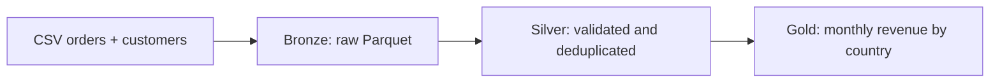

# PySpark Medallion Lakehouse (Local Parquet Demo)

**Category:** Distributed data processing / analytics-ready gold layer  
**Tools:** Python 3.10+, PySpark 3.5.x, Java 17, Parquet

## Business goal

Turn raw order events and customer records into high-quality monthly revenue by country.



- **Bronze:** Copy raw source rows to Parquet while preserving input columns.
- **Silver:** Validate identifiers, dates and amounts; select the most recent event for each order; standardize customer records.
- **Gold:** Join to customer dimension; sum revenue from completed orders by country and month.

## Run locally

**Requirements:** Install Java 17 and verify `java -version`; then:

```bash
python -m venv .venv
# On Windows: .venv\Scripts\activate
# On macOS/Linux: source .venv/bin/activate
pip install -r requirements.txt
python pipeline.py --output output
python -m unittest discover -s tests -v
```

Output: `output/bronze/`, `output/silver/`, `output/gold/` Parquet files.

## Engineering choices

- We use an explicit schema and type casting rather than relying entirely on CSV type inference.
- The Silver orders layer deduplicates events using the most recent timestamp per order.
- Gold includes only `completed` orders; invalid rows and unknown customer IDs are excluded.
- Outputs are rebuilt with `overwrite` in this **batch demonstration**. This is reproducible but **not** incremental streaming or Delta Lake MERGE.

## Interview-ready follow-up exercises

1. Replace Parquet with **Delta Lake** and build an idempotent `MERGE`.
2. Add a quarantine table for bad records and a data-quality scorecard.
3. Create an incremental watermark and validate late-arriving events.
4. Explain partitioning strategy, shuffles, skew, and an `explain()` plan.
5. Use Databricks workflows in a real Azure environment.

## Notes

This repository is a reproducible learning demonstration, not a benchmark or claim of a deployed lakehouse. Automated CI compiles the Python files and runs a small Spark integration test on GitHub runners. Java and PySpark compatibility depends on your machine.
